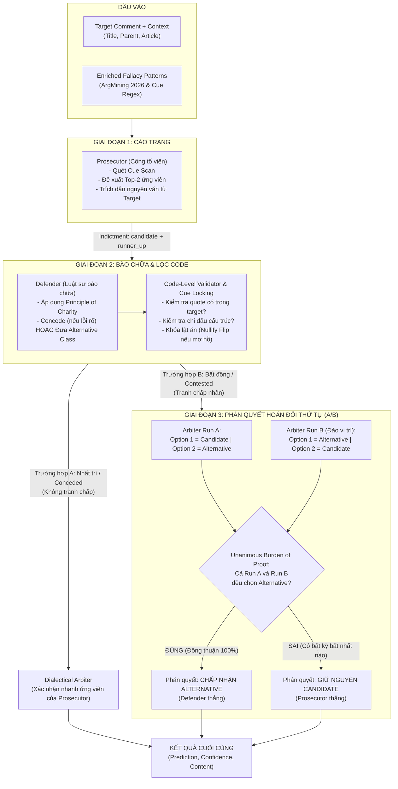

# KIẾN TRÚC HỆ THỐNG TRANH BIỆN ĐỐI KHÁNG BIỆN CHỨNG (ADVERSARIAL DIALECTICAL DEBATE)
## Phân tích Ngụy biện Logic Đa tác nhân trên Benchmark CoCoLoFa

---

> **Cập nhật Defender v1 (2026-10-25):** Classification hiện dùng diagnostic review: so sánh candidate/runner-up theo cơ chế suy luận; cho phép quote trùng; regex và độ dài quote chỉ là cảnh báo, không ép nhận thua. Các mô tả Cue Locking/hủy lật án ở bên dưới là cơ chế trước thay đổi này. Prosecutor và Arbiter giữ nguyên. Xem [hướng dẫn thử nghiệm](docs/DEFENDER_V1.md).

## 1. Bản chất & Mục tiêu Hệ thống

Dự án tập trung vào kiến trúc cốt lõi **Tranh biện Đối kháng Biện chứng (Adversarial Dialectical Debate)** để giải quyết 2 bài toán phân tích lỗi ngụy biện lập luận:
1. **Detection (Nhị phân)**: Phát hiện phát ngôn mục tiêu có chứa lỗi ngụy biện hay không (`Fallacious` vs `Non-Fallacious`).
2. **Classification (Đa lớp - 8 lớp đóng)**: Xác định chính xác 1 trong 8 loại ngụy biện thuộc danh mục benchmark CoCoLoFa:
   - *Appeal to Authority* (Ngụy biện thẩm quyền)
   - *Appeal to Majority* (Ngụy biện số đông)
   - *Appeal to Nature* (Ngụy biện tự nhiên)
   - *Appeal to Tradition* (Ngụy biện truyền thống)
   - *Appeal to Worse Problems* (Ngụy biện viện dẫn vấn đề tồi tệ hơn)
   - *False Dilemma* (Ngụy biện song đề sai)
   - *Hasty Generalization* (Ngụy biện khái quát hóa vội vã)
   - *Slippery Slope* (Ngụy biện trượt dốc không phanh)

> **Cơ sở lý thuyết**: Mô hình hóa tranh tụng pháp đình dựa trên *Dialogue Games & Burden of Proof (Gánh nặng chứng minh)* của triết gia lập luận **Douglas Walton**, kết hợp *Principle of Charity (Nguyên lý Nhân từ)* của **Quine & Davidson**.

---

## 2. Chi tiết Toàn bộ Đầu vào Hệ thống (Inputs)

Một lượt phân tích không chỉ nhận mỗi câu phát ngôn thô của người dùng, mà nhận **2 nhóm đầu vào song hành**:

```
                  ┌────────────────────────────────────────────────────────┐
                  │              CÁC THÀNH PHẦN ĐẦU VÀO                    │
                  └────────────────────────────────────────────────────────┘
                                      │
         ┌────────────────────────────┴─────────────────────────────┐
         ▼                                                          ▼
┌─────────────────────────────────┐        ┌──────────────────────────────────────┐
│  1. DỮ LIỆU MẪU CỤ THỂ          │        │  2. MẪU HÌNH NGỤY BIỆN KẾ THỪA       │
│     (Instance Data & Context)   │        │     (Enriched Fallacy Patterns)      │
├─────────────────────────────────┤        ├──────────────────────────────────────┤
│ • target_comment (Trọng tâm)    │        │ • Kế thừa từ nghiên cứu ArgMining    │
│ • parent_comment (Bình luận cha)│        │ • Dạng thức logic (Logical Forms)    │
│ • title (Tiêu đề bài viết)      │        │ • Cơ chế khiếm khuyết (Defect Mech)  │
│ • article (Nội dung bài báo)    │        │ • Dấu hiệu cú pháp (Syntactic Cues)  │
│                                 │        │ • Ràng buộc ranh giới (Boundaries)   │
└─────────────────────────────────┘        └──────────────────────────────────────┘
```

### 2.1. Dữ liệu Mẫu & Bối cảnh (Instance Data & Context)
- **`target_comment` (Phát ngôn mục tiêu)**: Đoạn văn bản trung tâm cần thẩm định. Toàn bộ cáo trạng và bằng chứng bắt buộc phải trích xuất nguyên văn (*verbatim substring*) từ đây.
- **`parent_comment` (Bình luận cha)**: Bình luận mà `target_comment` trực tiếp phản hồi lại. Cung cấp tiền đề hội thoại để đánh giá xem câu nói có bị hiểu lầm hay phản bác lạc đề hay không.
- **`title` & `article` (Tiêu đề & Nội dung bài báo)**: Ngữ cảnh tin tức khách quan từ Reddit. Dùng để luật sư bào chữa (`Defender`) kiểm chứng xem phát ngôn có cơ sở thực tế từ bài báo hay chỉ là phỏng đoán vô căn cứ.

### 2.2. Tri thức Tiên nghiệm: Mẫu hình Ngụy biện Kế thừa (Inherited Enriched Patterns)
Hệ thống **không để LLM tự suy diễn cảm tính** về định nghĩa ngụy biện, mà nạp sẵn hệ thống mẫu hình giàu tri thức (kế thừa từ công trình *ArgMining 2026: "Beyond Logical Forms: LLM-Extracted Patterns for Fallacy Classification"*). Bộ pattern này định nghĩa 5 tầng thông tin cho từng lớp ngụy biện:
1. **Core Definition**: Bản chất định nghĩa chuẩn theo lý thuyết lập luận.
2. **Abstract Logical Form**: Dạng thức logic trừu tượng (Ví dụ: với *Slippery Slope* là `$A \rightarrow B \rightarrow ... \rightarrow Z$` tất yếu tai họa mà thiếu bảo đảm nhân quả; với *False Dilemma* là khẳng định bắt buộc `$A \lor B$` triệt tiêu giải pháp thứ ba).
3. **Reasoning Defect Mechanism**: Cơ chế khiếm khuyết cụ thể (thay thế lý lẽ bằng uy tín của nguồn, bằng số đông, hoặc bằng tuổi đời tập quán).
4. **Syntactic Markers / Cue Patterns**: Các dấu hiệu ngôn ngữ và mẫu câu điển hình (ví dụ: *"where does it end?"*, *"who is next?"*, *"dr./prof stated"*, *"we have always done"*), được đối chiếu cả ở prompt lẫn regex code-level (`CUE_PATTERNS`).
5. **Boundary Constraints & Discrimination Rules**: Các quy tắc ranh giới phân biệt nghiêm ngặt:
   - *Quy tắc phân biệt Slippery Slope vs Appeal to Worse Problems*: Từ *"worse"* xuất hiện trong bài nếu cảnh báo về chính tương lai xấu đi của chủ đề A thì là *Slippery Slope*, chỉ khi nào lôi một vấn đề ngoại vi B hoàn toàn khác (trẻ em chết đói, chiến tranh) để dập tắt chủ đề A thì mới là *Appeal to Worse Problems*.
   - *Quy tắc Hasty Generalization*: Bắt buộc phải có bước nhảy từ một mẫu cá biệt/anecdote ra toàn thể quần thể. Phát ngôn ý kiến mạnh mồm không phải là ngụy biện này.
   - *Quy tắc Appeals*: Thẩm quyền, truyền thống, hay đa số phải đóng vai trò là lý lẽ duy nhất để bảo vệ kết luận chứ không phải chỉ là lời nhắc thoáng qua.

---

## 3. Sơ đồ Luồng Tranh luận (Adversarial Pipeline)



---

## 4. Chi tiết Từng Agent: Nhiệm vụ & Điểm Đặc Biệt

### 4.1. `Prosecutor` (Công tố viên lập luận)
- **Nhiệm vụ chính**:
  - Đóng vai trò bên công tố, phân tích `target_comment` dưới góc nhìn phê phán để vạch ra khiếm khuyết suy luận (*inferential defect*).
  - Tách bạch cấu trúc: Tiền đề hỗ trợ (`premise`) và Kết luận (`conclusion`).
  - Chạy giao thức **CUE SCAN** đối chiếu văn bản với 8 mẫu hình ngụy biện.
  - Thiết lập cáo trạng gồm: Ứng viên số 1 (`candidate_class`) kèm cơ chế lỗi và trích dẫn bằng chứng (`quote`); cùng Ứng viên dự phòng số 2 (`runner_up_class`) kèm trích dẫn (`runner_up_quote`).
- **Điểm đặc biệt (Special Traits)**:
  - **Chỉ trích xuất từ Target Comment**: Toàn bộ `quote` và `runner_up_quote` được kiểm duyệt chặt chẽ bằng code (`validate_prosecutor`), bắt buộc phải là xâu con nguyên văn nằm trong `target_comment`. Nghiêm cấm trích từ bài báo hay bình luận cha.
  - **Miễn nhiễm bẫy từ khóa bề mặt**: Được huấn luyện nhận biết sự khác biệt giữa từ ngữ thông thường và ngụy biện thực tế. Ý kiến gắt gao, cảm xúc mạnh hoặc thiếu nguồn dẫn chứng không bị coi là ngụy biện.

---

### 4.2. `Defender` (Luật sư bào chữa)
- **Nhiệm vụ chính**:
  - Đóng vai trò người bảo vệ phát ngôn, áp dụng **Nguyên lý Nhân từ (Principle of Charity)** để tìm cách hiểu hợp lý, đúng đắn và tích cực nhất cho người nói.
  - Khai thác bối cảnh bài báo (`article`) và bình luận cha (`parent_comment`) để chứng minh phát ngôn là: nghệ thuật tu từ/nói quá (hyperbole), câu hỏi tu từ, cảm thán đời thường, hoặc là nhận định đã có sẵn căn cứ từ bài báo.
  - Trong bài toán Phân loại (Classification), nếu Prosecutor chọn sai loại ngụy biện, Defender có quyền đề xuất một lớp cạnh tranh xác thực hơn (`alternative_class`) kèm trích dẫn phản biện (`counter_quote`).
- **Điểm đặc biệt (Special Traits)**:
  - **Quy tắc Nhân nhượng Bắt buộc (Critical Concession Rule)**: Nhân từ không có nghĩa là bao che mù quáng. Nếu phát ngôn phạm lỗi hiển nhiên (như khẳng định chắc nịch một chuỗi domino thảm họa hoặc ép buộc nhị nguyên tuyệt đối), Defender **bắt buộc phải nhận thua** (`concede_charge = true`).
  - **Cơ chế Khóa Chỉ Dấu (Code-Level Cue Locking)**: Trước khi lời bào chữa đến tay Trọng tài, hàm `validate_and_normalize_defender` sẽ chạy kiểm tra:
    1. Nếu trích dẫn đối trọng trùng lặp với trích dẫn của công tố $\rightarrow$ Hủy lật án, ép nhận thua.
    2. Nếu trích dẫn quá ngắn (< 3 từ) hoặc không có trong văn bản $\rightarrow$ Hủy lật án.
    3. Nếu lớp ứng viên của Prosecutor đã có dấu hiệu cấu trúc vững chắc (như có tên chuyên gia/tổ chức cho Authority, có mốc thời gian xưa nay cho Tradition) mà Defender chỉ phản bác bằng các lớp chung chung (như Hasty Generalization) mà thiếu bằng chứng $\rightarrow$ **Khóa chỉ dấu (Cue Locked), vô hiệu hóa nỗ lực lật án ngay lập tức**.

---

### 4.3. `DialecticalArbiter` (Thẩm phán / Trọng tài biện chứng)
- **Nhiệm vụ chính**:
  - Đóng vai trò thẩm phán độc lập, tối cao. Lắng nghe cuộc đụng độ giữa Công tố (`Prosecutor`) và Bào chữa (`Defender`).
  - Cân nhắc chứng cứ dưới nguyên lý **Gánh nặng chứng minh (Burden of Proof)** để tuyên án nhãn cuối cùng kèm mức độ tự tin (`confidence`) và lập luận phân xử (`content`).
- **Điểm đặc biệt (Special Traits)**:
  - **Phán quyết Hoán đổi Thứ tự (Order-Permuted Adjudication)**: Khi có sự tranh chấp nhãn giữa Prosecutor (`candidate`) và Defender (`alternative`), LLM rất dễ bị thiên vị thứ tự xuất hiện (Positional Bias - ưu tiên chọn phương án đứng trước). Để loại trừ triệt để hiện tượng này, hệ thống gọi Arbiter **2 lần riêng biệt**:
    - *Run A*: Trình bày Option 1 = Candidate, Option 2 = Alternative.
    - *Run B*: Đảo ngược Option 1 = Alternative, Option 2 = Candidate.
  - **Gánh nặng chứng minh Tuyệt đối (Unanimous Challenger Burden of Proof)**: Phán quyết chỉ được phép lật sang nhãn của Defender khi và chỉ khi **CẢ HAI LẦN CHẠY ARBITER ĐỀU BỎ PHIẾU CHO ALTERNATIVE**. Nếu có sự do dự (Run A chọn Alternative nhưng Run B chọn Candidate hoặc ngược lại), công tố viên sẽ được xử thắng và nhãn ban đầu của Prosecutor được giữ nguyên.

---

## 5. Bảng Đối chiếu Tóm tắt 3 Tác nhân

| Tác nhân | Nhiệm vụ Trọng tâm | Đầu vào Trực tiếp | Điểm Kỹ thuật Đặc biệt |
| :--- | :--- | :--- | :--- |
| **`Prosecutor`** (Công tố viên) | Vạch ra khiếm khuyết suy luận, quét dấu hiệu, chọn top-2 ứng viên ngụy biện. | Target comment + Context + Enriched Fallacy Patterns | Bắt buộc quote nguyên văn 100% từ Target Comment; miễn nhiễm bẫy từ khóa bề mặt. |
| **`Defender`** (Luật sư bào chữa) | Áp dụng Principle of Charity, tìm cách hiểu hợp lý nhất hoặc chỉ ra lớp ngụy biện đúng hơn. | Cáo trạng Prosecutor + Target + Parent + Article Context | Có *Critical Concession Rule* (nhận thua khi lỗi rõ); bị kiểm duyệt bởi *Cue Locking* (hủy lật án nếu thiếu bằng chứng). |
| **`DialecticalArbiter`** (Thẩm phán) | Cân xét tranh tụng khách quan theo gánh nặng chứng minh để ra phán quyết. | Cặp lựa chọn đối đầu (Candidate vs Alternative) + Trích dẫn chứng cứ | Cơ chế **Order Permutation** (chạy đảo vị trí 2 lần) + **Unanimous Burden of Proof** (phải thắng cả 2 lượt mới được lật án). |

---

## 6. Phụ chú: Các Module Khác Trong Codebase

Trong thư mục `src/`, bạn có thể thấy một số file như `ars_*.py`, `diagnostic.py`, `simplified.py`, `legacy_protocols/`:
- **Lý do tồn tại**: Đây là mã nguồn của các kiến trúc tiền nhiệm (như chẩn đoán tiêu chuẩn ARS, giao thức Round Robin/Cross-Examination) được giữ lại trong kho lưu trữ phục vụ việc chạy **Ablation Study (Thí nghiệm đối chứng)** trong bài báo khoa học.
- **Trọng tâm sản phẩm hiện tại**: Toàn bộ các cấu hình thực nghiệm chính thức hiện hành (`configs/*.adversarial.*.yaml`) đều kích hoạt chính xác duy nhất luồng **Adversarial Dialectical Debate** được mô tả trong tài liệu này.
