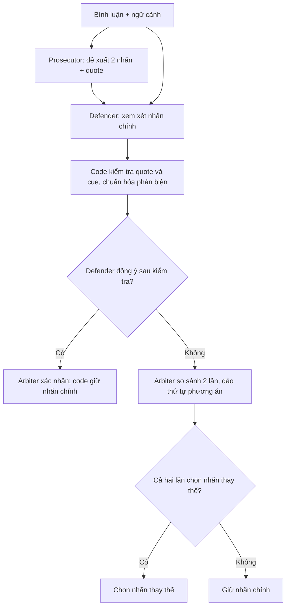

# Fallacy classification: bài toán và input/output

Hệ thống phân loại lỗi lập luận trong bình luận tin tức thành tám nhãn của **CoCoLoFa**, sử dụng tranh luận giữa các agent LLM. **Prosecutor** đề xuất các nhãn có thể phù hợp, **Defender** kiểm tra và phản biện nhãn chính, **DialecticalArbiter** phân xử giữa các cách diễn giải.

Các agent sử dụng cùng một model với prompt chuyên biệt cho từng vai trò. Phương pháp được so sánh với baseline phân loại trực tiếp bằng một lần gọi LLM.

## 1. Bài toán classification

**Input:** một bình luận đã được bộ dữ liệu gán là có fallacy, kèm ngữ cảnh. **Output:** đúng một trong tám loại fallacy và lời giải thích ngắn dựa vào văn bản. Đây là bài toán **single-label, closed-set, 8 lớp**: không được trả nhãn ngoài taxonomy hoặc nhiều nhãn cùng lúc.

Mục tiêu nghiên cứu là kiểm tra phản biện giữa các vai trò LLM có cải thiện classification so với một LLM gọi trực tiếp hay không, với số call, token và thời gian ra sao. Đây là đánh giá cấu trúc suy luận, không xác minh tính đúng sai của bài báo bằng nguồn bên ngoài.

### 1.1. Tám nhãn cần phân biệt

| Giá trị JSON bắt buộc | Cơ chế cần nhận diện |
|---|---|
| `Appeal to Authority` | Dùng uy tín/chức danh của nguồn làm căn cứ đủ để chấp nhận kết luận |
| `Appeal to Majority` | Dùng mức độ phổ biến/đồng thuận làm căn cứ cho tính đúng hay chấp nhận được |
| `Appeal to Nature` | Dùng tính tự nhiên/phi tự nhiên để biện minh giá trị, an toàn hoặc hành động |
| `Appeal to Tradition` | Dùng truyền thống/tính lâu đời để biện minh việc chấp nhận hoặc duy trì |
| `Appeal to Worse Problems` | Dùng một vấn đề nghiêm trọng hơn để gạt vấn đề đang bàn sang bên |
| `False Dilemma` | Coi các phương án bị giới hạn là toàn bộ khả năng, bỏ qua lựa chọn liên quan |
| `Hasty Generalization` | Suy rộng từ mẫu/bằng chứng hạn chế sang một nhóm hoặc phạm vi lớn hơn |
| `Slippery Slope` | Suy diễn sự leo thang/hệ quả tiếp nối mà không có đủ căn cứ cho bước chuyển |

Đây là tóm tắt để đọc tài liệu; prompt và rule đang chạy nằm trong `src/dialectical/`. Việc nhắc đến chuyên gia, số đông, truyền thống hoặc dùng chữ “tự nhiên” chưa tự nó xác định nhãn. Phải xem chúng có làm căn cứ cho kết luận hay không.

### 1.2. Dữ liệu và ranh giới thông tin

| Split | Số mẫu classification gold-positive |
|---|---:|
| Train | 3.168 |
| Dev | 927 |
| Test | 481 |

File JSON gốc còn chứa các mẫu `fallacy: none`; loader loại những mẫu đó khi chọn task classification. Việc chọn tập dựa vào gold là **thiết lập đánh giá**, không phải nhãn được truyền cho LLM. Agent chỉ biết giả định chung rằng mỗi mẫu đầu vào thuộc một trong tám lớp; không biết nhãn thật của từng mẫu.

Không có bước đọc bài báo trên web, truy hồi bằng chứng hay học từ nhãn của mẫu đang chạy. Mỗi mẫu được xử lý độc lập. Nếu câu có nhiều cách diễn giải, hệ thống vẫn phải chọn một cơ chế trung tâm; đây là giới hạn của thiết lập một nhãn.

### Ví dụ tổng

Các ví dụ là **minh họa tự tạo, không phải trace benchmark**. Confidence do model tự báo, chưa được hiệu chuẩn.

Input **X**, mặc định title + comment cha trực tiếp + TARGET:

```json
{
  "title": "Debate about book restrictions",
  "parent_comment": "What policy should the council adopt?",
  "comment": "We must either ban these books or our whole society will eventually collapse. There is no middle ground."
}
```

Output classification hiển thị cho người dùng:

```json
{
  "prediction": "False Dilemma",
  "confidence": 0.84,
  "content": "The comment forces a choice between banning books and societal collapse, excluding other options."
}
```

Không có comment cha thì dùng chuỗi rỗng. Toàn bài báo chỉ được cấp khi chọn `context: article`; mặc định `paper` không cấp toàn bài. Chỉ TARGET được phân loại: title và comment cha giúp hiểu ngữ cảnh, không được tự động coi lập luận của comment cha là của tác giả TARGET.

Trong ví dụ, cả False Dilemma và Slippery Slope có vẻ liên quan. Kết luận minh họa chọn False Dilemma vì câu khẳng định trực tiếp “không có lựa chọn ở giữa”; không chỉ dựa vào từ “collapse”.

## 2. Quy trình phân loại bằng tranh luận



Quy tắc ra quyết định **ưu tiên giữ nhãn chính** khi phản biện chưa đủ thuyết phục. Runner-up của Prosecutor giúp Defender cân nhắc; nhánh tranh chấp đưa nhãn chính và nhãn thay thế thực tế của Defender vào Arbiter.

### 2.1. Chuẩn bị dữ liệu — code

- **Input:** bản ghi dataset, title, quan hệ comment cha, annotation.
- **Output:** `ModelInput` có dạng X; giữ gold và metadata ngoài input LLM.
- Code: `src/data/loader.py`.

### 2.2. Prosecutor — agent đề xuất

- **Input:** X + định nghĩa tám nhãn + prompt vai trò; chưa thấy phản biện.
- **Output P:** hai nhãn khác nhau, cơ chế lỗi và quote nguyên văn từ TARGET.

| Trường | Ý nghĩa |
|---|---|
| `has_fallacy_charge` | Luôn là `true` trong classification; không phải một bước quyết định có fallacy hay không |
| `candidate_class` | Nhãn chính mà Prosecutor ưu tiên |
| `defect_mechanism`, `quote` | Cơ chế sai và bằng chứng cho nhãn chính |
| `runner_up_class` | Giả thuyết thứ hai, phải khác nhãn chính |
| `runner_up_defect`, `runner_up_quote` | Cơ chế và bằng chứng cho giả thuyết thứ hai |

```json
{
  "has_fallacy_charge": true,
  "candidate_class": "False Dilemma",
  "defect_mechanism": "The comment treats banning the books or societal collapse as exhaustive options.",
  "quote": "We must either ban these books or our whole society will eventually collapse.",
  "runner_up_class": "Slippery Slope",
  "runner_up_defect": "The comment also predicts an unsupported severe consequence.",
  "runner_up_quote": "our whole society will eventually collapse."
}
```

### 2.3. Defender — agent phản biện

- **Input:** X + P tại `reports.prosecutor_indictment`.
- **Nhiệm vụ:** đồng ý với primary hoặc đưa một nhãn thay thế có căn cứ. Không được dùng nhãn không-fallacy cho task classification.
- **Output D**, ví dụ đồng ý:

```json
{
  "concede_charge": true,
  "alternative_class": "None",
  "charitable_interpretation": "The explicit denial of a middle ground supports False Dilemma more directly than a consequence-chain reading.",
  "counter_quote": "There is no middle ground."
}
```

Nếu phản đối, `concede_charge` là false và `alternative_class` phải là một nhãn khác. Defender có thể chọn runner-up hoặc một nhãn khác trong tám lớp. Quote và cơ chế thay thế phải vượt kiểm tra code trước khi chuyển sang tranh chấp.

`alternative_class: "None"` chỉ có nghĩa **không đề xuất nhãn thay thế**, không phải nhãn đầu ra cuối và không có nghĩa “câu không chứa fallacy”. `concede_charge: true` nghĩa là chấp nhận phân loại chính của Prosecutor.

Một output phản đối minh họa trên cùng X, để thấy format nhánh còn lại; không khẳng định phản biện này tốt hơn:

```json
{
  "concede_charge": false,
  "alternative_class": "Slippery Slope",
  "charitable_interpretation": "The predicted societal collapse may be the central unsupported consequence rather than the restricted choice.",
  "counter_quote": "our whole society will eventually collapse."
}
```

### 2.4. Validator — code, không phải agent

- **Input:** X, P, D.
- **Kiểm tra:** cấu trúc JSON, nhãn hợp lệ, trích dẫn có trong TARGET và các điều kiện về dấu hiệu lập luận.
- **Output:** D sau kiểm tra/chuẩn hóa. Ví dụ D ở trên vẫn là đồng ý.
- Phản biện không đạt điều kiện được chuẩn hóa thành đồng ý. Khi phân tích lỗi, cần đối chiếu response model với kết quả sau bộ kiểm tra để xác định bước nào ảnh hưởng tới nhãn cuối.
- Code: `src/dialectical/schemas.py`, `src/dialectical/validation.py`.

Phản biện có thể bị chuyển thành đồng ý nếu nhãn thay thế trùng nhãn chính, quote không nằm trong TARGET, quote giống quote chính, quá ngắn hoặc thiếu dấu hiệu mà bộ lọc yêu cầu cho nhãn thay thế. Ngưỡng độ dài quote là `min(3, số từ TARGET)`. Các điều kiện này là heuristic và cần được xem xét khi đánh giá lỗi phân loại.

### 2.5. DialecticalArbiter — agent trọng tài

**Nhánh đồng ý:** nhận X và phần reports sau:

```json
{
  "comment": "We must either ban these books or our whole society will eventually collapse. There is no middle ground.",
  "candidate": {
    "class": "False Dilemma",
    "quote": "We must either ban these books or our whole society will eventually collapse."
  }
}
```

Sample output:

```json
{
  "prediction": "False Dilemma",
  "confidence": 0.84,
  "content": "The statement explicitly excludes a middle ground."
}
```

Ở nhánh xác nhận, kết quả cuối giữ `candidate_class` ngay cả khi Arbiter trả nhãn khác.

**Nhánh tranh chấp:** nhận X và hai phương án dưới dạng `option_1`, `option_2`, mỗi phương án có `class`, `quote`. Gọi hai lần với thứ tự đảo nhau. Mỗi call chỉ được chọn một trong hai nhãn, output có `prediction`, `confidence`, `content`.

Ví dụ phần `reports` của lượt A khi alternative là Slippery Slope:

```json
{
  "comment": "We must either ban these books or our whole society will eventually collapse. There is no middle ground.",
  "option_1": {
    "class": "False Dilemma",
    "quote": "We must either ban these books or our whole society will eventually collapse."
  },
  "option_2": {
    "class": "Slippery Slope",
    "quote": "our whole society will eventually collapse."
  }
}
```

Lượt B hoán đổi nguyên hai object `option_1` và `option_2`. Arbiter nhận input ban đầu cùng hai nhãn và quote tương ứng. Mỗi output có cùng dạng JSON ba trường như ví dụ Arbiter ở trên; `prediction` chỉ được nằm trong cặp đang so sánh.

Ví dụ bộ tổng hợp nhận:

```json
{
  "primary": "False Dilemma",
  "alternative": "Slippery Slope",
  "run_a": "Slippery Slope",
  "run_b": "False Dilemma",
  "final_prediction": "False Dilemma"
}
```

Đây là **minh họa input/output của luật tổng hợp**, không phải schema response của một agent. Vì hai lượt không cùng chọn alternative nên giữ primary. Hai thứ tự cùng dùng một model, không phải đồng thuận giữa hai model độc lập.

### 2.6. Điều phối, lưu trace và đánh giá — code

| Module | Input | Output |
|---|---|---|
| Engine | X + task + model config | Trace có prediction, Prosecutor, Defender, Arbiter, stop_reason, thời gian |
| Client | System prompt + user payload + schema | Response JSON, usage, cache và audit; retry lỗi theo cấu hình |
| Bộ tổng hợp | Hai prediction của Arbiter khi tranh chấp | Chỉ đổi sang alternative nếu cả hai lượt chọn alternative |
| Scorer | Prediction + gold ngoài model | Accuracy, macro-F1, confusion matrix và thống kê từng nhãn |

Mỗi call LLM có payload chung gồm `input`, `reports`, `history`, `instruction`, `question`, `plan`. Trong quy trình này, `history` rỗng và `plan` là null; thông tin giữa các bước được truyền qua `reports`. Trace ghi tên luồng thực thi trong `planner_protocol`.

## 3. Đánh giá classification và chi phí

### 3.1. Nhãn cuối được quyết định thế nào?

| Kết quả sau Validator | Luật nhãn cuối | Số call thông thường |
|---|---|---:|
| Defender đồng ý | Gọi xác nhận, code giữ primary | 3 |
| Defender phản đối; hai Arbiter đều chọn alternative | Đổi sang alternative | 4 |
| Defender phản đối; hai Arbiter khác nhau hoặc có lượt chọn primary | Giữ primary | 4 |
| Baseline single LLM | Dùng dự đoán một lần gọi trực tiếp | 1 |

Các số trên chưa tính retry; nếu cache hit thì không cần gọi API cho response tương ứng. Khi tranh chấp, confidence cuối là trung bình confidence hai lượt, kể cả khi hai lượt không chọn cùng nhãn; vì vậy không diễn giải nó như xác suất đúng đã hiệu chuẩn.

### 3.2. Metric và phân tích lỗi

- **Accuracy:** số mẫu đúng / tổng mẫu được đánh giá.
- **Macro-F1:** tính F1 riêng từng nhãn rồi lấy trung bình tám nhãn, giúp nhìn hiệu quả khi tần suất lớp khác nhau.
- **Confusion matrix:** hàng là gold, cột là prediction; chỉ ra các cặp thường bị lẫn.
- **Precision/recall/F1 từng nhãn:** phân biệt nhận nhầm vào một nhãn với bỏ sót nhãn đó.
- **Chi phí:** ghi số request/cache hit, input/output token, latency và chi phí ước tính khi có đơn giá.

So sánh debate với baseline trên **cùng split, cùng danh sách mẫu, cùng model và ngữ cảnh**. Kiểm tra riêng các mẫu Prosecutor sai được sửa đúng, các mẫu Prosecutor đúng bị làm sai, và ảnh hưởng của Validator. API/contract failure phải được báo cùng coverage, không bỏ âm thầm để báo điểm đẹp hơn.

### 3.3. Output nghiên cứu được lưu

| Artifact trong thư mục run | Nội dung |
|---|---|
| `manifest.json` | Config/source/data fingerprint, split và danh sách mẫu được chọn |
| `predictions.jsonl` | Gold phục vụ chấm điểm, prediction cuối và trace của từng mẫu |
| `samples/*.json` | Kết quả từng mẫu để resume |
| `raw_calls.jsonl` | Request/response đã ghi audit, giúp đối chiếu trước và sau xử lý |
| `summary.json` | Metric, coverage, usage và thông tin tổng hợp |

Gold trong artifact đánh giá không có nghĩa agent được nhìn thấy gold. Lời giải thích agent được lấy từ cùng response tạo ra quyết định ở bước đó; không được xem là toàn bộ suy luận nội bộ hay bằng chứng chắc chắn về nguyên nhân dự đoán.

## 4. Paper chính

1. [CoCoLoFa — Yeh, Wan & Huang, EMNLP 2024](https://aclanthology.org/2024.emnlp-main.39/): dataset và thiết lập classification tám lớp đang dùng.
2. [Logical Fallacy Detection — Jin et al., Findings EMNLP 2022](https://aclanthology.org/2022.findings-emnlp.532/): nền tảng LOGIC/LOGICCLIMATE và cấu trúc lập luận.
3. [Boosting Logical Fallacy Reasoning in LLMs via Logical Structure Tree — Lei & Huang, EMNLP 2024](https://aclanthology.org/2024.emnlp-main.730/): hướng khai thác cấu trúc logic; repo này không triển khai LST.
4. [Improving Factuality and Reasoning in Language Models through Multiagent Debate — Du et al., ICML 2024](https://arxiv.org/abs/2305.14325): nền tảng nhiều instance LLM trao đổi và phản biện.
5. [Encouraging Divergent Thinking in Large Language Models through Multi-Agent Debate — Liang et al.](https://arxiv.org/abs/2305.19118): tranh luận đối lập và judge.
6. [PARD: Deconstruct, Diagnose, and Deliberate, Findings ACL 2026](https://aclanthology.org/2026.findings-acl.1227/): tài liệu liên quan về phân vai và điều phối suy luận nhiều agent.

## 5. Code và giới hạn

- Điều phối: `src/engine.py`; quy trình tranh luận: `src/dialectical/debate.py`.
- Prompt: `src/dialectical/prompts.py`; contract: `src/dialectical/schemas.py`.
- Quote/cue rules: `src/dialectical/validation.py`; định nghĩa: `src/dialectical/fallacy_definitions.py`.
- Single baseline: `src/baseline/single.py`.

Giới hạn: quy tắc ưu tiên primary và bộ lọc quote/cue có thể chặn một cách diễn giải hợp lý; lời giải thích của model có thể sai; nhiều call làm tăng chi phí và thời gian. Thiết lập một nhãn buộc hệ thống chọn một lớp dù câu có thể mơ hồ. Kết quả smoke dùng mock chỉ xác minh quy trình chạy; hiệu quả phân loại phải được đánh giá trên dữ liệu có nhãn.
