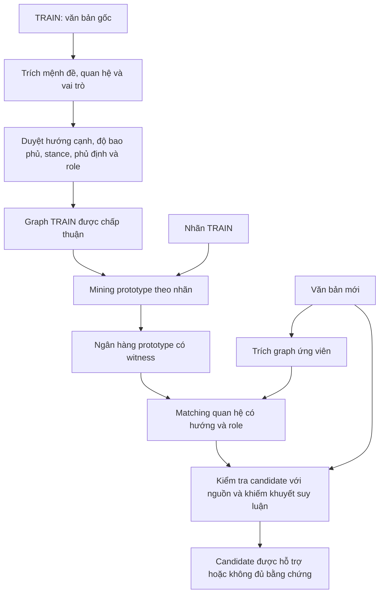

# Reviewed fallacy graph method

Experimental graph pipeline: source-anchored propositions, directed relations,
warrant slots, reviewed TRAIN admission, witnessed pattern prototypes per label,
candidate matching and selective LLM verification. The method requires review
before graph admission to the pattern bank. Valid JSON is not semantic accuracy.

## Ý tưởng phương pháp

Mục tiêu là phân loại ngụy biện từ **cách các mệnh đề được dùng để suy luận**.
Văn bản được chuyển thành graph có hướng. Từ graph TRAIN, hệ thống tìm các
cấu trúc lập luận lặp lại theo nhãn; với văn bản mới, hệ thống tìm cấu trúc ứng
viên tương ứng rồi kiểm tra bằng nguồn gốc trước khi kết luận.

Graph giúp truy ngược quyết định: đâu là tiền đề, đâu là kết luận, tác giả sử
dụng hay phản đối suy luận đó, và bước suy luận có khiếm khuyết gì. Việc nhắc
đến chuyên gia, số đông hoặc truyền thống tự nó chưa đủ xác định ngụy biện.

### Biểu diễn graph

- **Proposition:** mệnh đề gắn với đoạn trích và vị trí trong nguồn.
- **InferenceApplication:** một lần suy luận từ một hoặc nhiều tiền đề tới
  mệnh đề đích. Đích có thể là một suy luận khác khi phản bác warrant.
- **Scheme và role:** giả thuyết về kiểu lập luận và vai trò của mệnh đề,
  chẳng hạn nguồn thẩm quyền/khẳng định, mẫu/quần thể, điều kiện/hệ quả.
- **Thuộc tính ngữ nghĩa:** người phát biểu, thái độ sử dụng hay phản đối,
  phủ định, mức độ chắc chắn và tính giả định; kèm liên kết về nguồn.

Ví dụ minh họa: “Nhiều người tin X, vì vậy X đúng”. Quan hệ cần biểu diễn là
**sự phổ biến của niềm tin được dùng làm lý do cho tính đúng của X**. Nếu tác
giả nói “Nhiều người tin X nhưng điều đó không chứng minh X đúng”, thái độ với
suy luận đã thay đổi; không được xác nhận tác giả mắc Appeal to Majority.
Đây là ví dụ về biểu diễn mong muốn, không phải kết quả extractor đã được bảo đảm.

### Luồng xử lý



1. **Trích graph không nhận nhãn gold của mẫu.** LLM đề xuất mệnh đề, quan hệ
   và role; code kiểm tra ID, đoạn trích và ràng buộc cấu trúc. Title và parent
   comment là ngữ cảnh, không mặc nhiên là quan điểm của tác giả.
2. **Duyệt graph TRAIN cho tầng expert.** Review gắn với hash của đúng snapshot,
   kiểm tra cả quan hệ trung tâm bị bỏ sót. Automatic silver là nhánh nghiên cứu
   riêng và phải ghi rõ mức độ giám sát.
3. **Mining prototype có bằng chứng.** Một nhãn có nhiều prototype thay thế nhau.
   Mỗi prototype phải xuất hiện trong graph witness thực tế; không ghép cạnh từ
   các mẫu khác nhau thành một đường suy luận chưa từng xuất hiện. Support tính
   theo article, có xét nhãn cạnh tranh và bootstrap recovery.
4. **Matching graph mới.** Bản hiện tại dùng motif canonical ở hai mức: `strict`
   giữ thuộc tính chi tiết; `core` giữ cấu trúc hướng/role và dùng modality,
   polarity, speech act, event role làm tín hiệu xếp hạng mềm. Đây vẫn là matching
   chính xác theo từng mức, chưa phải tìm mọi subgraph tương tự về ngữ nghĩa.
5. **Verifier kiểm tra mapping, cơ chế, stance và defect riêng biệt.** Một kiểu
   lập luận có thể được dùng hợp lý. Hệ thống xuất riêng quyết định phân loại
   và quyết định xác nhận ngụy biện của tác giả; nhánh selective có thể không
   chọn khi thiếu bằng chứng.

### Phân công giữa code và LLM

LLM đề xuất các quyết định ngữ nghĩa: quan hệ, scheme, role và đánh giá warrant
trong ngữ cảnh. Code quản lý grounding, validation, chuẩn hóa motif, đếm witness,
mining, matching và tổng hợp kết quả. Lợi ích dự kiến là giải thích được quyết
định bằng cấu trúc và nguồn. Graph có cải thiện accuracy hay không cần được đo
bằng thí nghiệm đối chứng.

### Kết quả và hạn chế hiện tại

Bản automatic silver gần nhất tạo 49 pattern từ 3.168 graph TRAIN. Trên 481 mẫu
TEST, 475 graph đạt source contract nhưng chỉ 183 mẫu có candidate mang nhãn
gold; ranking đúng 160/481 (33,26%), macro-F1 0,4192. Chỉ số này tính cả weak/forced
prediction, không phải chất lượng riêng của nhánh selective. Xem
[kết quả và cách diễn giải](stability/LATEST_GRAPH_RESULTS.md).

Các nút thắt là thiếu/sai quan hệ trung tâm, nhầm scheme/role và matching nhạy
với cách tách mệnh đề hoặc số tiền đề. Motif thường xoay quanh một application,
chưa bao quát mọi chuỗi suy luận nhiều bước. Verifier có thể xác nhận candidate
sai. JSON hợp lệ, witness tồn tại và bootstrap cao đều chưa chứng minh graph
đúng ngữ nghĩa. Vì vậy, tầng expert vẫn yêu cầu duyệt TRAIN; repo chưa cung cấp
ngân hàng tám nhãn được chuyên gia phê duyệt.

## Architecture

`stability/ontology_v2.py` defines literal spans, propositions, commitment and
inference applications. `decomposed_source_v2.py` extracts propositions and then
relations over fixed IDs. `warrant_slots_v2.py` adds constrained scheme roles;
adoption/concession typing is owned by code. Validators preserve original source
anchors, direction, endpoint constraints and rejected attempts.

`reviewed_training_v2.py` admits only reviews bound to the exact graph snapshot,
covering relations, central coverage, speaker/stance, negation/modality and roles.
Human review is the default; explicit assistant silver is a research tier.
`patterns_v2.py` mines alternative witnessed prototypes, with distinct-article
support, competing-label purity and bootstrap recovery. It never merges separate
examples into an unwitnessed path. `verify_v2.py` and `final_selection_v2.py`
separate selective classification from confirmed author-fallacy detection.

See [method decision](stability/FINAL_METHOD_DECISION.md),
[annotation guide](stability/RELATION_ANNOTATION_GUIDE.md),
[paper survey](stability/PAPER_SURVEY.md) and
[Market output workaround](stability/MARKET_REPAIR.md).
Historical diagnostic modules are retained for comparison; the supported
full-TRAIN extraction entry point below uses an explicit manifest. Older
`pipeline.dataset()` experiments require local historical `run-live/samples.json`
and are not the full-TRAIN workflow.

## Setup and full TRAIN extraction (PowerShell)

Run from `graph_method/stability` in the cloned repository. Python 3.11 is used.
Place the licensed dataset at the repository's
`data/cocolofa/classification/train.json`. Set credentials in the repository-root
`.env` using the variable names in `../.env.example`, or set environment variables.
`GRAPH_REPO_ROOT` optionally selects another data/credential root.

```powershell
python -m venv .venv-syntax
.\.venv-syntax\Scripts\python.exe -m pip install -r requirements-syntax.txt
.\.venv-syntax\Scripts\python.exe prepare_full_train.py
powershell -NoProfile -ExecutionPolicy Bypass -File .\run_market_train.ps1 -Name full_train_market_gptoss120b_r1
```

The launcher uses Market `gpt-oss-120b`, four workers and `prompt_json`:
the schema goes into the prompt rather than provider-native constrained decoding.
Requests are cached by input/prompt/configuration; rejected outputs remain visible.
The rolling failure guard stops queued work if fewer than 80% of the latest
32 completed graphs meet source contracts. This is an operational guard, not a
semantic accuracy gate. The same run name is protected by an exclusive lock.

```powershell
Get-Content .\full_train_market_gptoss120b_r1.log -Tail 20 -Wait
```

Outputs include graphs, stage metrics, raw calls and an HTML report. These remain
local and are ignored by Git. The full manifest uses TRAIN only, with all rows
marked induction; it provides no independent validation split.

## Reviewed pattern bank

Provide an approvals JSON list. Each entry needs `sample_id`, `graph_sha256`
(from `reviewed_training_v2.graph_fingerprint`), a named `reviewer`,
`reviewer_type: "human"` and all five `checks` set to true:
`source_relations`, `central_coverage`, `speaker_stance`, `negation_modality`,
`warrant_roles`. Do not synthesize approvals from class labels or model agreement.

```powershell
.\.venv-syntax\Scripts\python.exe reviewed_training_v2.py full_train_market_gptoss120b_r1_graphs.json approvals.json --output reviewed_pattern_bank.json
```

The bank reports missing supported labels; an extraction run does not imply a
ready bank. No expert approvals or eight-label-ready bank are shipped.

## Verification and observed limits

```powershell
.\.venv-syntax\Scripts\python.exe -m unittest discover -s . -p "test_*.py"
```

Small TRAIN regression fixtures are included; bulk training data, API caches,
credentials and generated reports are excluded. Tests run without API calls.
The Market 100-case diagnostic finished 100/100 requests with 99 graphs meeting
the final contracts: propositions 100/100, relations 100/100, warrant 99/100.
One warrant was rejected for binding its claim to the wrong target. No request
hit the output-token limit. This measures output contracts, not semantic accuracy:
manual inspection still found an evaluative phrase treated as a causal outcome.
The selected method therefore retains reviewed TRAIN admission and abstention.

## Multi-resolution research workflow (2026-10-20)

The latest experimental path adds soft roundtrip source review, targeted retries,
literal span repair, strict/core motif mining and frozen-bank evaluation. It is
an **automatic silver** experiment; it does not replace the human-review admission
boundary above. See [matching policy](stability/PATTERN_MATCHING_CORE.md) and
[observed results](stability/LATEST_GRAPH_RESULTS.md).

After full TRAIN extraction, run from `graph_method/stability`:

```powershell
powershell -NoProfile -ExecutionPolicy Bypass -File .\run_market_roundtrip.ps1
.\.venv-syntax\Scripts\python.exe retry_problem_graphs_once.py
.\.venv-syntax\Scripts\python.exe retry_span_fixed.py
.\.venv-syntax\Scripts\python.exe build_multires_patterns.py
.\.venv-syntax\Scripts\python.exe evaluate_frozen_bank.py --split dev --name dev_multires_oss120b_r1
```

These commands make API calls except pattern mining. They require local dataset,
credentials and preceding run artifacts, which are intentionally not committed.
`evaluate_frozen_bank.py --plan` inspects frozen inputs without starting evaluation.
Use `--split test` only for a frozen final evaluation; do not tune on exposed TEST
cases. `probe_direct_graph_retrieval.py` is explicitly an exposed-TEST diagnostic,
not an independent benchmark or a replacement evaluation.
