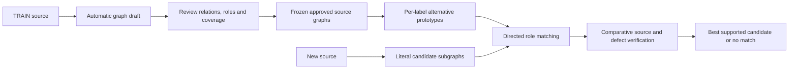

# Method decision ? 2026-10-18

Decision: retain the graph approach with reviewed TRAIN graph supervision and selective source-grounded matching. Do not approve fully automatic induction of stable fallacy pattern graphs from the current prompting-only extractor.

This is an architectural selection and a no-go decision for unattended pattern induction, not a claim that all original performance gates passed. Exact source anchors, valid JSON, parser eligibility and agreement between two calls cannot certify source semantics.

## Selected architecture

1. Immutable original source spans and explicit proposition IDs. Separate literal content, speaker/author commitment, hypothetical events and inference applications. Preserve negation and modal scope. Parent/title remain context unless a real adoption cue licenses a specific reference.
2. TRAIN supervision: propose clause/role graphs automatically, review their actual premise?target directions, ownership, stance and scheme roles before allowing them into the pattern bank. Store reviewer identity/type and unresolved items. Assistant silver annotations are not expert human gold. Fallacy class labels group accepted graphs; they do not manufacture their argument structure.
3. Per-label pattern graph is an alternative set of witnessed prototypes. Count distinct training articles, competing-class support and bootstrap stability. Never union separate examples into a path that no training source contains. Keep multiple mechanisms per label rather than force one common connected graph.
4. Candidate extraction preserves literal witnesses and explicit unresolved alternatives. Dependency event/choice frames generate possible endpoints; they do not prove relation semantics. A future risk and the recommendation it motivates are separate applications. Bare choice sets and rejected restrictions must not be converted into fictitious priority/support edges.
5. Match mandatory directed role topology, retain exact node mapping and source provenance; compare multiple candidates per label. Do not allow generic support shape alone to establish a fallacy. Current native matcher uses exact canonical motifs; broader partial matching is a design extension, not measured as implemented here.
6. Final verifier judges source fidelity separately from fallacy mechanism/defect. Pattern similarity does not prove a defect. Preserve a genuine no-match/unclear outcome; an optional forced benchmark label must be marked as such, not shown as confirmed author fallacy.

## Risk treatment

| Risk | Treatment | Remaining limitation |
|---|---|---|
| Correct quotes, wrong edges | Review directed relation and stance against original source before pattern admission | LLM reviewer can still agree with an error or reject an implicit reason |
| Missing central relation | Explicit forecast/choice inventories and coverage audit; missing is not a negative success | Parser and proposition splitter can miss mechanisms |
| Speaker/context confusion | Code-owned source identity and explicit positive adoption license | A positive cue does not prove its precise contextual referent |
| Fake event chain | Hypothetical event facets, effect spans, modality scope, non-event exclusions | Dependency parse and metaphor can be wrong |
| Error repeated across train | Reviewed training supervision and source witnesses per prototype | Repeated automatic agreement is not gold supervision |
| Excessive rejection | Report relation coverage and abstention jointly with precision | Selective operation reduces automatic coverage |
| Brittle merged pattern | Alternative witnessed prototypes with article support/purity/bootstrap | Eight supported labels and held-out recall still need actual demonstration |
| Benchmark mismatch | Separate known-positive type classification from author-fallacy detection | A label alone does not supply graph or defect gold |

## What was actually implemented in this round

- `faceted_source_v2.py`: literal effect/condition spans; separate mandatory per-forecast decisions; no generic projection emission; source-anchored choice frames.
- `semantic_review_v2.py`: per-edge source review; unconfirmed edges and dependent application chains excluded from native pattern occurrences. Original proposals remain visible.
- `pair_source_v2.py`: diagnostic fixed-endpoint pair classification with explicit none. It is not a full parser and does not recover projections, priority comparisons or application-target undercuts.
- `final_campaign_v2.py`: frozen reserved-TRAIN audit and source review reporting; no test loading.
- Pinned local spaCy environment; raw API requests/responses and rejected attempts preserved.

## Preliminary decisive evidence, before independent audit completion

- Prior few-shot extractor completed 8/9 difficult graphs but exactly retained only 3/6 applicable central relation references in that group. Exact span coverage is stricter than semantic equivalence and is not total precision.
- Faceted variant still emitted sixteen support applications for source371; independent source review rejected fourteen. It retained the land-theft reasoning but also rejected some potentially pragmatic readings. Thus the reviewer reduces contamination and does not establish universal correctness.
- Fixed-pair diagnostic on the same source emitted five support decisions, missed its clear central land-theft?restitution-doubt relation and still selected questionable edges. Merely shrinking the output decision space does not solve semantic extraction.
- Therefore, stable unattended TRAIN pattern induction is rejected. Reviewed TRAIN graph supervision is a substantive requirement of the selected method, not a claim that prompting alone now meets the original semantic gate.

Final independent audit metrics and terminal request status are recorded below when the frozen runs finish. No model or source prompt is to be tuned on that audit.

## Enforced training boundary

`reviewed_training_v2.py` implements the selected training admission boundary. Each review must match the exact source/annotation/class snapshot hash and explicitly cover source relations, central coverage, speaker/stance, negation/modality and warrant roles. Expert mode requires a named human review; assistant silver requires explicit `--allow-silver` and is labeled research silver. No human approvals have been fabricated or supplied by this work. LLM edge review alone cannot satisfy that admission policy. The pattern bank reports missing supported labels and is not marked ready without eight supported labels and measured bootstrap recovery. A reviewer record is traceability, not a mathematical semantic guarantee.

Observed typed-role failure: source48's dentist anecdote was assigned historical_practice in one accepted graph. The current automated semantic reviewer checks source direction/kind/stance, not full warrant-role semantics. This is why its supported verdict is insufficient for expert TRAIN admission.

## Terminal diagnostic results

The faceted nine-case source run finished: propositions9/9 first-contract valid (cached calls retained), relation graphs7/9 final valid, source review39proposed applications?5admitted. This admission count is neither precision nor accuracy. Known controls remain unresolved, so the method fails the original automatic stability gate.

The pair diagnostic finished3/4 valid with semantic errors; it is not selected as a replacement full parser.

Fixed-graph reviewer repetition finished2/2 paired graphs, with only10/20 identical witnessed edge decisions (50%). This is a small diagnostic, not a population estimate; nevertheless it directly fails the95% repeat target on these cases. The disagreement is semantic, not JSON formatting. Source48's news/consensus and dentist links changed from supported to unsupported; source371 acquired several previously rejected support edges. Repeated LLM review is therefore not a stable substitute for reviewed training supervision.

`RELATION_ANNOTATION_GUIDE.md` fixes the review policy, including implicit reasons versus adjacency, criticism of a topic versus stance on an inference, and separate choice/event/warrant semantics. `final_selection_v2.py` adds a selective final contract: invalid/unwitnessed mappings produce no supported candidate; a classified mechanism does not imply confirmed author fallacy. `verify_v2.verify` exports both selective classification and author-fallacy decisions while preserving the old diagnostic ranking. No new final-verifier API quality result is claimed from this additive output change.

## Selected flow

The review boundary is required for the selected TRAIN method. The source parser and source-only verifier remain proposal tools. Human review has not been performed by this run; no expert-approved eight-label bank or supervised parser is claimed. All sixteen reserved TRAIN cases are being completed without source-prompt tuning; their final results are additional evaluation evidence, not training approvals.

## Completed independent TRAIN audit

All16 reserved articles finished with no source-code/prompt tuning. Source graphs14/16 contract-valid; three of these contain no applications. Source review admitted24/60 proposed applications and still retained one definite reversed-direction control. The strict exact endpoint audit covers1/16 positive controls; this is not exhaustive precision or a general semantic accuracy estimate. Split clauses and joint-premise arity differ from the assistant references; actual failures are independently documented in FINAL_SOURCE_AUDIT_NOTES.md.

The final selection remains reviewed TRAIN graph supervision with selective matching. Fully automatic prompt-only pattern induction is rejected by both known-source diagnostics and independent source failures; repeated source review also fails the repeat target. No further prompt expansion is selected as the remedy. More automation requires actual relation/role supervision, consistent with the supervised argument-mining route discussed in PAPER_SURVEY.md. No parser fine-tuning or expert-approved pattern bank is claimed.
